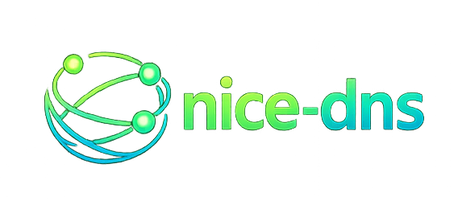
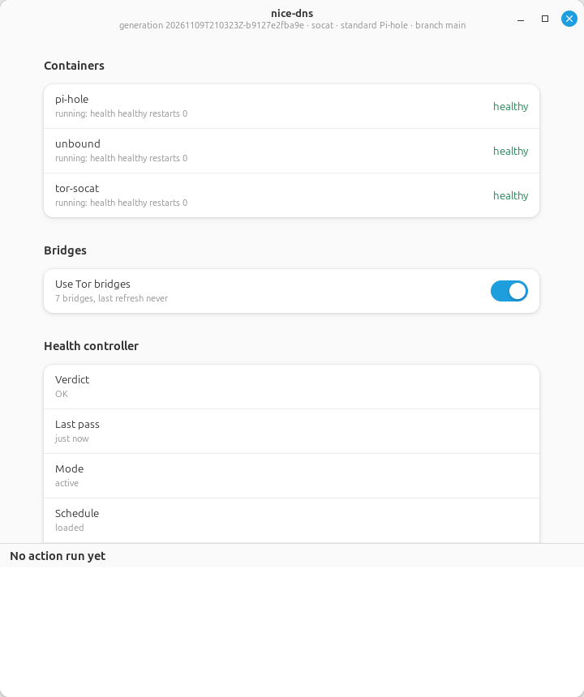
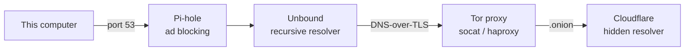

<h1 align="center">
  <br>
  nice-dns
</h1>

<p align="center">
  <strong>DNS that never leaves your machine in plaintext.</strong><br>
  Pi-hole → Unbound → Tor → Cloudflare's hidden resolver.
</p>

<p align="center">
  <a href="LICENSE.md"></a>
  <a href="https://github.com/sureserverman/nice-dns/issues"></a>
</p>

---

Your ISP sees encrypted Tor traffic — nothing else.

## The `nice-dns` command

Once installed, one command manages the stack on Linux and macOS, from any directory:

```bash
nice-dns install [haproxy|socat] [--hardened] [--branch B]   # from a checkout
nice-dns reinstall [haproxy|socat] [--hardened|--standard] [--branch B] [--local]
nice-dns restart
nice-dns status [--tsv]
nice-dns bridges on|off|status
nice-dns update [--check] [--force]
nice-dns uninstall
```

- **`nice-dns install`** is for a checkout: `./nice-dns install`. A first install on a new machine uses the `curl` line below, which leaves `nice-dns` in `~/.local/bin`. If that directory is not on your `PATH`, the install's last line gives the full path and the line to add.
- **`--branch`** always clones that branch, even from a checkout. `--hardened` needs a `pi-hole-hardened` checkout: next to your nice-dns checkout, or where the last hardened install found it, or in `~/.local/share/nice-dns/`.
- **`nice-dns reinstall`** installs again with the recorded proxy, Pi-hole flavour and branch; options override them. It clones the branch first. If that fails because DNS is down, the running stack is untouched and `--local` uses the source kept at the last install.
- **`nice-dns restart`** restarts the whole stack and waits for DNS to answer. It runs no DNS command itself; on macOS the stack's own start script re-pins DNS and bounces Mullvad, as it does whenever it rebuilds. Either way this costs a Tor bootstrap of a minute or more.
- **`nice-dns status`** says what is installed, what the health controller last saw and did, the bridges, the admin page and the last update check. It only reads files, so it answers at once; `--tsv` prints the same as rows for scripts (docs/cli-contract.md). It exits 1 when nothing is installed and 2 when something it reads cannot be read.
- **`nice-dns bridges off`** stops using obfs4 bridges: Tor connects straight to its guards. Use it where the bridges are slow. Your ISP then sees plain Tor connections instead of obfs4 traffic: it can tell you use Tor, though still not what you look up. **`nice-dns bridges on`** goes back to the bridges. Either one restarts the proxy (on macOS, the whole stack) and waits for DNS, which costs a Tor bootstrap; asking for the mode already set restarts nothing. The bridge pool is kept while bridges are off, so `on` uses the last good set again. `nice-dns bridges status` prints the mode, the bridge count and the last refresh. The mode lives in `~/.config/nice-dns/bridges-mode.env`.
- **`nice-dns update`** asks GitHub whether your branch's commit differs from the installed one (usually: is newer). If it does, it installs it like `nice-dns reinstall`, with the recorded choices; `--check` only asks, and `--force` reinstalls even when nothing differs. If it cannot tell (offline, DNS down, or an install from a modified checkout), it installs nothing and says why. An install from a local commit GitHub does not have counts as different, so `update` would install the branch's commit over it.
- **`nice-dns uninstall`** removes the stack, gives host DNS back, then removes the command.

## The window (Linux)



On Linux the installer also puts `nice-dns-gui` on the machine, with a
launcher in the applications menu. The window shows what the stack is doing:
each container, the health controller's last verdict, the bridges switch,
recent actions, and whether an update is waiting. Its buttons restart the
stack, check for and install an update, turn bridges on or off, run or stop
the health controller, reinstall and uninstall. Each one runs the `nice-dns`
command, and its output appears in the window. Root steps ask for your
password through the system's dialog (polkit). The window is a release asset,
checked against `release/assets.lock`; an install without network goes on
without it and says so. It needs GTK 4.14 and libadwaita 1.5 (Ubuntu 24.04,
Linux Mint 22 or later); on an older system the install goes on without it.

## Install

Run as a **regular user** (no `sudo`). macOS needs macOS 26+ on Apple silicon and [Homebrew](https://brew.sh/).
Debian 12 and Whonix 17 are not supported: their `mawk` is too old for the
patterns the controller and installer use.

```bash
# Debian / Ubuntu
curl -fsSL https://raw.githubusercontent.com/sureserverman/nice-dns/main/install-deb.sh -o install-deb.sh && bash install-deb.sh

# macOS
curl -fsSL https://raw.githubusercontent.com/sureserverman/nice-dns/main/install-mac.sh -o install-mac.sh && bash install-mac.sh
```

Re-running the installer prepares the new images first, then replaces the running stack, and puts the previous one back if anything fails. Tor state, the Pi-hole lists and the admin password are kept; only `uninstall` removes them.

**Mullvad VPN (Linux).** The installer reads Mullvad's DNS setting, records
it, and ends with `mullvad dns set custom 127.0.0.1`: with any other setting
a connected Mullvad overwrites the resolver pin. If Mullvad's custom DNS is
already `127.0.0.1`, Mullvad is connected and nice-dns is not running, the host has no DNS, so the
fetch above fails: run `mullvad dns set default` first. A failed install, and
the uninstall, put the recorded setting back.

### Arguments

```
install-{deb,mac}.sh [haproxy|socat|uninstall] [branch]
```

| Arg | Meaning |
|-----|---------|
| `haproxy` *(default)* | Tor proxy via HAProxy — `sureserver/tor-haproxy` |
| `socat` | Tor proxy via socat — `sureserver/tor-socat`, lighter |
| `branch` | Git branch to install from (default `main`) |

Example: `... install-deb.sh socat dev`

## Verify

```bash
dig @127.0.0.1 cloudflare.com        # Linux
dig @172.31.240.250 cloudflare.com   # macOS
```

Pi-hole admin UI:

| OS | URL |
|----|-----|
| Linux | <http://localhost:8880/admin> |
| macOS | <http://172.31.240.250/admin> |

The admin password is generated once per install and kept across reinstalls.
It is never printed. Read it with:

```bash
cat ~/.local/state/nice-dns/secrets/pihole/pihole_webpassword
```

To choose your own, write it to that file (one line, mode `600`) and run the
installer again. The uninstall deletes it.

What you change in the admin UI's lists survives restarts, reinstalls,
upgrades and a switch between the standard and hardened installers: allowed
and denied domains, regex rules, groups, clients and blocklists you added
(with the domains they last downloaded). Pi-hole's other settings come from
nice-dns's own configuration on every install. Tor's state and Unbound's
root trust anchor are kept the same way, so a restart does not bootstrap Tor
from nothing. The uninstall removes all of it.

## How it works



Linux runs the stack as a rootless Podman pod managed by user-mode systemd
quadlets. The pod publishes DNS on `127.0.0.1:53` and the Pi-hole UI on
`127.0.0.1:8880`, so only this computer can use them, not other devices on
its network. Inside the pod, the services share a network namespace and talk
over localhost:

| Service | Pod-local endpoint | Role |
|---------|--------------------|------|
| Pi-hole | `127.0.0.1:53` | Ad-blocking DNS; upstream is Unbound |
| Unbound | `127.0.0.1:5335` | Recursive resolver; DoT upstream to the Tor proxy |
| Tor proxy | `127.0.0.1:853` | Tunnels DoT through Tor to Cloudflare's `.onion` |

macOS drives Apple's `container` runtime from a login-triggered LaunchAgent and
keeps Pi-hole reachable at `172.31.240.250`.

## Updates and rollback

Re-running the installer builds a new generation of the stack next to the
running one and switches over only when it answers. If the install fails,
the previous generation comes back on its own. Its images stay on the
machine for that until the install after next.

To go back to an earlier version on purpose, run that version's installer:
the second argument is the git branch to install from
(`... install-deb.sh haproxy <branch>`).

A small controller (`nice-dns-health`) checks the chain every minute and
refreshes the Tor bridges once a day, leaving out bridges that carry
queries badly (with `nice-dns bridges off`, the refresh is skipped). See
[health/README.md](health/README.md).

## Uninstall

```bash
nice-dns uninstall
```

Without the command, use the installer:

```bash
curl -fsSL https://raw.githubusercontent.com/sureserverman/nice-dns/main/install-deb.sh -o install-deb.sh && bash install-deb.sh uninstall
curl -fsSL https://raw.githubusercontent.com/sureserverman/nice-dns/main/install-mac.sh -o install-mac.sh && bash install-mac.sh uninstall
```

Removes quadlets/LaunchAgent, pods, containers, images, the network, and restores system DNS. On Linux it also gives Mullvad back the DNS setting it had before nice-dns, unless that setting was changed since. Shared system tweaks (PPA pin, sysctl, AppArmor, Homebrew packages, Rosetta) are left in place.

## License

[GPLv3](LICENSE.md). Report issues [here](https://github.com/sureserverman/nice-dns/issues).
